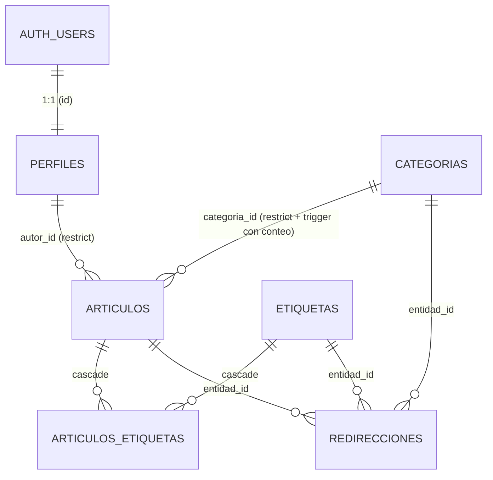
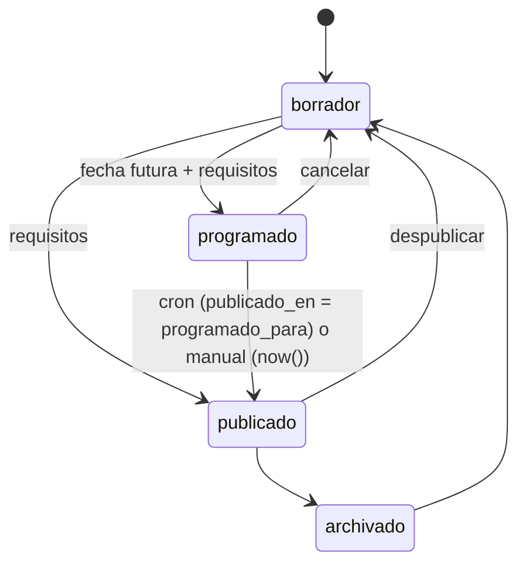

# Modelo de datos: Modelo de contenido

**Feature**: [spec.md](spec.md) · **Decisiones**: [research.md](research.md) · **Revisión**: arquitecto-db (2026-10-18), con los 12 bloqueantes incorporados.

## Diagrama



## Tipos y configuración

| Objeto | Definición |
|---|---|
| `rol_miembro` | enum `admin`, `editor` |
| `estado_articulo` | enum `borrador`, `programado`, `publicado`, `archivado` |
| `tipo_entidad` | enum `articulo`, `categoria`, `etiqueta` |
| `public.es_sin_tildes` | text search config, copia de `spanish`, con `unaccent, spanish_stem`. Se usa **siempre** combinada con `pg_catalog.spanish` y con el nombre calificado (D12) |

Extensiones que se instalan: `unaccent`, `pg_net`, `pg_cron` (además de `pgcrypto` y `supabase_vault`, que ya vienen).

---

## `perfiles`

| Columna | Tipo | Restricciones |
|---|---|---|
| `id` | `uuid` | PK, FK → `auth.users(id)` `on delete restrict` |
| `nombre` | `text` | `not null`, longitud 1–80 (con `btrim`) |
| `biografia` | `text` | `≤ 500` |
| `avatar` | `jsonb` | null o una imagen válida |
| `rol` | `rol_miembro` | `not null default 'editor'` |
| `activo` | `boolean` | `not null default true` |
| `creado_en` / `actualizado_en` | `timestamptz` | `not null default now()` |

**Triggers**
- `privado.crear_perfil()`: `after insert on auth.users`, definer. Toma `rol` de `raw_app_meta_data->>'rol'` (editor por defecto) y `nombre` de `raw_user_meta_data->>'nombre'` (si falta, la parte local del email). Pone `activo = raw_app_meta_data ? 'rol'`: una cuenta que no creó el servidor nace inactiva.
- `a20_proteger_perfil` (`before update`): para peticiones de cliente, `id` y `creado_en` son inmutables, y cambiar `rol` o `activo` (con `is distinct from`) exige `es_admin()`.
- `z10_garantizar_admin` (`after update`): toma `pg_advisory_xact_lock(hashtext('perfiles.ultimo_admin'))` y lanza `ultimo_admin` si no queda ningún admin activo (RF-023).
- `z90_notificar_cambio_autor` (`after update`, cuando cambian `nombre`, `biografia` o `avatar`): emite un único mensaje `tipo: 'autor'`.

Los perfiles no se borran: la FK es `restrict` y no hay política de delete.

## `categorias` y `etiquetas` (misma forma)

| Columna | Tipo | Restricciones |
|---|---|---|
| `id` | `uuid` | PK |
| `nombre` | `text` | `not null`, longitud 1–60; `unique index (lower(nombre))` |
| `slug` | `text` | `not null default ''` (lo genera `a10`), `unique`, `check (slug ~ '^[a-z0-9]+(-[a-z0-9]+)*$')` |
| `descripcion` | `text` | `≤ 300` |
| `creado_en` / `actualizado_en` | `timestamptz` | |

**Triggers**
- `a10_asignar_slug`
- `a90_actualizado_en`
- `z10_registrar_redireccion` (si cambió el slug)
- `z20_recalcular_articulos` (si cambió el nombre): recalcula la búsqueda de los artículos relacionados, sin notificar por cada uno.
- `z30_borrar_redirecciones` (`after delete`)
- `z90_notificar_cambio`
- Solo en `categorias`: `a05_impedir_borrado_en_uso` (`before delete`), que lanza `categoria_en_uso` con el conteo en `detail`.

## `articulos`

| Columna | Tipo | Restricciones |
|---|---|---|
| `id` | `uuid` | PK |
| `titulo` | `text` | `not null`, longitud 1–120 |
| `slug` | `text` | `not null default ''` (lo genera `a10`), `unique`, mismo formato que las taxonomías |
| `extracto` | `text` | `≤ 300` |
| `titulo_seo` | `text` | `≤ 60` |
| `descripcion_seo` | `text` | `≤ 160` |
| `imagen_destacada` | `jsonb` | null o una imagen válida |
| `contenido` | `jsonb` | `not null default '[]'`, `check (privado.contenido_valido(contenido))` |
| `estado` | `estado_articulo` | `not null default 'borrador'` |
| `programado_para` | `timestamptz` | |
| `publicado_en` | `timestamptz` | lo gestiona el sistema |
| `autor_id` | `uuid` | `not null default auth.uid()`, FK → `perfiles` `restrict`; inmutable para el cliente |
| `categoria_id` | `uuid` | FK → `categorias` `restrict` |
| `version` | `integer` | `not null default 1` |
| `busqueda` | `tsvector` | lo gestiona el sistema |
| `creado_en` / `actualizado_en` | `timestamptz` | |

**Checks**
- `estado not in ('programado','publicado') or (categoria_id is not null and jsonb_typeof(contenido) = 'array' and jsonb_array_length(contenido) > 0)`
- `estado <> 'programado' or programado_para is not null`
- `estado <> 'publicado' or publicado_en is not null`

**Índices**
- `unique (slug)`
- `(estado, publicado_en desc)` → listados, sitemap
- `(categoria_id, publicado_en desc)` → FK, conteo de categoría en uso, páginas de categoría (no parcial)
- `(autor_id)`
- `(programado_para) where estado = 'programado'` → cron
- GIN `(busqueda)`

**Triggers** (se ejecutan en orden alfabético, D21; ninguno usa `update of`)

| Nombre | Momento | Responsabilidad |
|---|---|---|
| `a05_id_inmutable` | before upd | `id` inmutable para todos los roles (`privado.impedir_cambio_id`, también en categorías y etiquetas) |
| `a10_asignar_slug` | before ins/upd | Genera o normaliza el slug y le agrega un sufijo único |
| `a20_campos_sistema` | before ins/upd | Solo para el cliente (`privado.es_cliente()`). En el insert fuerza `version = 1`, `publicado_en = null`, `estado = 'borrador'`, `programado_para = null`, `creado_en` y `actualizado_en = now()`. En el update conserva `autor_id`, `creado_en` y `publicado_en` (y, hasta H2, `estado` y `programado_para`) |
| `a30_controlar_version` | before upd | Con `pg_trigger_depth() > 1` conserva la versión. En otro caso exige que `new.version = old.version` (si no, `conflicto_version`) y la incrementa |
| `a40_validar_estado` | before ins/upd | En el update aplica la matriz de transiciones (`estado_invalido`); en el insert, el cliente ya viene forzado a borrador y el sistema o seed puede insertar en cualquier estado y los requisitos de publicación (`requisitos_publicacion` con `detail`). Exige `programado_para > now()` al entrar a programado o al cambiar la fecha (`fecha_no_futura`). Si queda publicado sin `publicado_en`, lo asigna: `now()` si la hace un cliente, `programado_para` si la hace el cron. Nunca pisa un valor existente. Limpia `programado_para` al salir de programado |
| `a50_calcular_busqueda` | before ins/upd | Recalcula siempre: A título; B extracto, categoría y etiquetas; C `bloques_a_texto` |
| `a90_actualizado_en` | before upd | `actualizado_en = now()` |
| `n10_notificar_borrado` | before del | Captura las etiquetas y notifica si el artículo era público |
| `z10_registrar_redireccion` | after upd | Si `new.slug is distinct from old.slug` y `old.publicado_en` no es null, registra la redirección con `on conflict do update`. Si el nuevo slug figuraba como `slug_anterior`, borra esa redirección |
| `z20_borrar_redirecciones` | after del | Borra las redirecciones de la entidad |
| `z90_notificar_cambio` | after ins/upd | Notifica si la fila era o es pública e ignora los cambios que solo afectan a `busqueda`, `version` o `actualizado_en` |

> `privado.es_cliente()` vale `current_setting('role', true) in ('anon','authenticated')`. Sigue siendo correcto dentro de funciones definer, porque `SECURITY DEFINER` no modifica el GUC `role` (verificado). El seed y el cron corren como `postgres`, así que no son clientes.

### Máquina de estados



Requisitos para publicar o programar: título, categoría y al menos un bloque. `publicado_en` se asigna solo en la **primera** publicación y después no cambia.

## `articulos_etiquetas`

| Columna | Tipo | Restricciones |
|---|---|---|
| `articulo_id` | `uuid` | FK → `articulos` `on delete cascade` |
| `etiqueta_id` | `uuid` | FK → `etiquetas` `on delete cascade` |
| PK | `(articulo_id, etiqueta_id)` | |

- Índice `(etiqueta_id, articulo_id)`.
- **No tiene triggers ni políticas de escritura.** La única vía de escritura para los clientes es el RPC `asignar_etiquetas` (D22, `security definer` con chequeo `es_equipo()`), que es atómico, incrementa la versión una sola vez (`a50` recalcula la búsqueda) y emite una única notificación. El seed escribe como `postgres` y después llama a `privado.recalcular_busqueda`.

## `redirecciones`

| Columna | Tipo | Restricciones |
|---|---|---|
| `id` | `uuid` | PK |
| `tipo_entidad` | `tipo_entidad` | `not null` |
| `slug_anterior` | `text` | `not null` |
| `entidad_id` | `uuid` | `not null`; la integridad la mantienen los triggers `z20`/`z30` |
| `creado_en` | `timestamptz` | |

`unique (tipo_entidad, slug_anterior)` · índice `(entidad_id)` · solo la escriben los triggers definer.

## Vista `autores_publicos`

```sql
create view public.autores_publicos with (security_invoker = false, security_barrier = true) as
select p.id, p.nombre, p.biografia, p.avatar
from public.perfiles p
where exists (select 1 from public.articulos a
              where a.autor_id = p.id and a.estado = 'publicado' and a.publicado_en <= now());
revoke all on public.autores_publicos from public, anon, authenticated;
grant select on public.autores_publicos to anon, authenticated;
```

Hay un test que verifica que **insert, update y delete fallan** como `anon` y como `authenticated` (B1).

## Imagen (sub-esquema jsonb compartido)

`{ ruta, ancho, alto, alt, decorativa }`. Las reglas completas están en [contracts/bloques.md](contracts/bloques.md). El check en la base (`privado.imagen_valida(jsonb)`) solo verifica que sea un objeto, que tenga `ruta` string, que `ancho` y `alto` sean números y que tenga `alt` no vacío o `decorativa = true`.

## Funciones

**Expuestas** (`public`; todas `stable` y con `search_path = ''` salvo indicación)

| Función | Seguridad | Roles | Notas |
|---|---|---|---|
| `buscar_articulos(consulta text, limite int = 12, desplazamiento int = 0)` | invoker | anon, authenticated | Filtro explícito de publicados; `least(limite, 50)`; devuelve `total` (D12) |
| `resolver_redireccion(tipo tipo_entidad, slug text)` | invoker | anon, authenticated | Join contra la entidad, que pasa por la RLS (D24) |
| `previsualizar_slug(texto text, tipo tipo_entidad)` | definer, con chequeo `es_equipo()` | authenticated | `case` estático, sin SQL dinámico |
| `asignar_etiquetas(articulo_id uuid, etiqueta_ids uuid[], version int)` | **definer** con chequeo `es_equipo()` | authenticated | `volatile`; atómica; única vía de escritura de etiquetas (D22) |

**Internas** (`privado`): `es_cliente`, `es_equipo`, `es_admin`, `es_publico(estado, publicado_en)` (predicado de visibilidad para el código definer; la vista y las políticas lo repiten inline por **decisión** de no conceder `execute` sobre funciones de `privado` a los clientes, porque en vistas y políticas los permisos de las funciones se verifican con el rol de quien consulta; validación C3-M1), `mensaje_articulo(id, slugs, categoria_ids, etiqueta_ids_extra = '{}')` (mensaje único de notificación de artículos; une las etiquetas actuales con las anteriores que le pasa `asignar_etiquetas`), `registrar_redireccion`/`borrar_redirecciones` (genéricas, con las condiciones en el `WHEN` de cada trigger), `slugs_afectados(actual, anterior)`, `slugificar`, `slug_disponible(tipo, texto, excluir)` (la fuente única del sufijo; la usan `asignar_slug` y `previsualizar_slug`), `tipos_bloque`, `contenido_valido`, `imagen_valida`, `bloques_a_texto`, las funciones de los triggers, `recalcular_busqueda(uuid)`, `notificar_cambio_publico(jsonb)`, `publicar_programados()`.
- Las funciones puras (`slugificar`, `tipos_bloque`, `contenido_valido`, `imagen_valida` y `bloques_a_texto`) son `immutable` y van con `search_path = ''` y nombres calificados (`extensions.unaccent`).
- `es_equipo`, `es_admin` y `asignar_slug` son `security definer`; `asignar_slug` lo necesita porque el editor no tiene `execute` sobre `slugificar`.

## Privilegios (D20)

La primera migración revoca los privilegios por defecto de Supabase y después concede **solo** esto:

| Objeto | anon | authenticated |
|---|---|---|
| schema `privado` | usage | usage |
| `privado.es_cliente`, `es_equipo`, `tipos_bloque`, `contenido_valido`, `imagen_valida` | execute | execute |
| `privado.es_admin` | — | execute |
| Resto de `privado.*` | — | — |
| `categorias`, `etiquetas` | select | select, insert, update, delete |
| `articulos` | select | select, insert, update, delete |
| `articulos_etiquetas` | select | select (escritura solo vía `asignar_etiquetas`) |
| `redirecciones` | select | select |
| `perfiles` | — | select, update |
| `autores_publicos` | select | select |
| `buscar_articulos`, `resolver_redireccion` | execute | execute |
| `previsualizar_slug`, `asignar_etiquetas` | — | execute |
| `net.http_post`, `net.http_get` | no se puede revocar (lo otorga `supabase_admin`); mitigado (D14) | ídem |

Ningún rol de cliente recibe TRUNCATE ni REFERENCES. Los tests usan `table_privs_are` y `function_privs_are`.

## Políticas RLS

Todas las tablas tienen RLS. `E` = `(select privado.es_equipo())`, `A` = `(select privado.es_admin())`, `PUB(a)` = `a.estado = 'publicado' and a.publicado_en <= now()`.

| Tabla | Política | Rol | Operación | Condición |
|---|---|---|---|---|
| `perfiles` | `perfiles_select_equipo` | authenticated | select | `E` |
| | `perfiles_update_propio` | authenticated | update | using y check: `id = (select auth.uid()) and E` |
| | `perfiles_update_admin` | authenticated | update | using y check: `A` |
| `categorias`, `etiquetas` | `*_select` | anon, authenticated | select | `true` |
| | `*_escritura_equipo` | authenticated | insert / update / delete | `E` (using y check) |
| `articulos` | `articulos_select_publico` | anon | select | `PUB(articulos)` |
| | `articulos_select_equipo` | authenticated | select | `PUB(articulos) or E` |
| | `articulos_insert_equipo` | authenticated | insert | check: `E and autor_id = (select auth.uid())` |
| | `articulos_update_equipo` | authenticated | update | using y check: `E` |
| | `articulos_delete_admin` | authenticated | delete | `A` |
| `articulos_etiquetas` | `ae_select_publico` | anon | select | `exists (select 1 from articulos a where a.id = articulo_id and PUB(a))` |
| | `ae_select_equipo` | authenticated | select | la misma condición `or E` |
| `redirecciones` | `redirecciones_select` | anon, authenticated | select | `tipo_entidad <> 'articulo' or exists (select 1 from articulos a where a.id = entidad_id)` (hereda la RLS) |
| `storage.objects` | `medios_select` | authenticated | select (listar) | `bucket_id = 'medios' and E`. Los archivos se sirven por URL pública. Bucket limitado a imágenes de hasta 5 MB |
| | `medios_insert_equipo` / `medios_update_equipo` / `medios_delete_equipo` | authenticated | insert / update / delete | `bucket_id = 'medios' and E` |

Cada política tiene al menos un test pgTAP positivo y uno negativo.

## Job programado

- `cron.schedule('publicar-programados', '* * * * *', 'select privado.publicar_programados()')`. La función usa `for update skip locked`.
- `cron.schedule('limpiar-historial-cron', '0 3 * * *', $$delete from cron.job_run_details where end_time < now() - interval '7 days'$$)`

## Secretos (Vault)

- `url_web_revalidacion`: en Linux local, `http://172.17.0.1:4321` (gateway de Docker; `host.docker.internal` no resuelve sin `extra_hosts`). Se verifica en el quickstart.
- `secreto_revalidacion`: el mismo valor que `SECRETO_REVALIDACION`.

Solo `postgres` (y `service_role`) pueden leer `vault.decrypted_secrets`. `net.http_request_queue` es legible por PUBLIC (no se puede revocar), así que el secreto **no** se envía: viajan solo la marca de tiempo y la firma HMAC (D14). Hay un test que verifica que el secreto no aparece en la cola.
